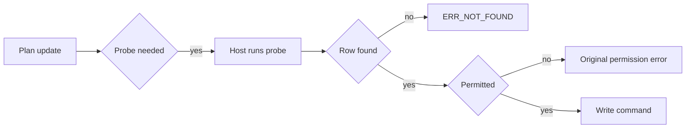
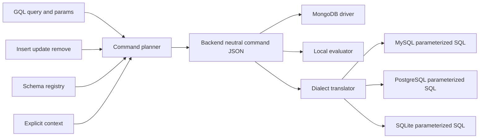

# rust-store

**A pure-logic Rust core for multi-backend data access: GQL in, backend-neutral command JSON out, parameterized SQL for MySQL / PostgreSQL / SQLite on request — no driver, no IO, no clock.**


Current release **5.3.2** — `rust-store-core` on crates.io, `rust-store-node` on npm, `rust-store-py` on PyPI. Mainline `6.0.0` and maintenance branch `5.3.3` are staged but **unreleased** (see [CHANGELOG](./CHANGELOG.md)).

> 中文: [README.md](./README.md)

- One query language planned once, executed on MongoDB, MySQL, PostgreSQL or SQLite.
- Two bindings that only convert JSON, so Node.js and Python cannot drift apart.
- 380 test functions across 30 files pin the contracts; the engine never opens a connection.

---

## Two in the morning, one table, two answers

Imagine the on-call engineer at 2 a.m., staring at one table, `orders`, and two numbers. The
MongoDB deployment shows the three most recent items of every order — the view the
operations team refreshed all day. The PostgreSQL deployment shows all of them. Order
8841 has 3 items on one side and 11 on the other. 87 orders disagree. Nothing threw an
exception: both statements parsed, both returned rows, both looked correct in code review.

The statement had been written by hand, and during a refactor the clause that limits
children per parent — a window function partitioned by the foreign key — was dropped.
The application had no way to notice, because no layer knew that a clause was missing.
MongoDB had been right all along; the second answer was simply a different question.

The fix was not a better SQL string. It was to stop hand-writing the second answer. A
query is now planned once into one canonical shape — MongoDB command JSON — and every
relational answer is derived from that shape by a pure function that must state, out
loud, what it could not translate. The **command planner** is the protagonist here; SQL
is only its shadow. That is what this repository is.

## What it actually does

`rust-store-core` turns three inputs — a schema registry, a GQL query or a write
payload, and an explicit permission context — into inert JSON commands for a host to
execute. The same commands are then translated, still without touching a database, into
parameterized SQL for the relational backends. Nothing is buffered, retried or executed
on your behalf: every public step is an `input -> output` function you can unit-test
without a server.

| Concern | `rust-store-core` | Host (`nodejs-store` / `py-store` / your service) |
| --- | --- | --- |
| GQL parsing and validation | yes | — |
| Command planning (find / aggregate / writes) | yes | — |
| MongoDB command JSON → SQL translation | yes | — |
| Flat JOIN rows → nested documents | yes | — |
| Permission decision (schema, field, relation, row) | yes | — |
| `agg` computed columns | evaluated inline | — |
| `fn` / `asyncFn` computed columns | declares and injects dependencies | executes the callbacks |
| Connection, pool, transaction, retry | — | yes |
| DDL, indexes, migrations | — | yes |
| Clock, id generation, randomness | — | yes |

The output of the read path is a `QueryPlan` — `{ collection, mode, commands,
postprocess, sort }` — where `commands` is MongoDB command JSON carrying a location
quadruple (`source`, `database`, `schema`, `collection`) so the host knows which
connection to use. Writes return a `command` plus the document as it will land, after
defaults and computed values.

## How it works

### MongoDB is the canonical dialect

Planning happens once, into statements a MongoDB driver already understands: `find`,
`aggregate`, `countDocuments`, `insertOne`, `updateMany`, `deleteMany`. Relations are
compiled into `$lookup` / `$addFields` by the engine; `$pipeline` passthrough was
removed and is a parse error, not a silent no-op. SQL is then produced from that same
command by `dialect::translate`, with no second query model to keep in sync.

The translation is where the dialects diverge, and it is confined to one layer:
PostgreSQL uses `$n` placeholders and `RETURNING`; MySQL and SQLite use `?`; identifiers
are back-quoted on MySQL and double-quoted elsewhere. Root `$group` / `$having` becomes
`GROUP BY` / `HAVING`; a relation aggregate predicate becomes `EXISTS` / `NOT EXISTS`;
a relation-rolling `agg` column becomes a derived-table `LEFT JOIN`; a per-parent top-N
becomes `ROW_NUMBER() OVER (PARTITION BY fk ORDER BY ...)` — the exact clause whose
absence started the night.

### Untranslatable is a receipt, not a guess

`translate` returns `{ backend, stmts, warnings, unsupported }`. When a segment cannot
be pushed down safely, `stmts` deliberately omits it and `unsupported` names the code,
the alias and the reason. The host must reject or degrade; it must never execute the
statement as if it were the whole query. Two-phase plans use a `PHASE1_IDS` placeholder
that the host replaces with the ids from the first command, then calls
`restore_sort_order` to put the final list back in the order the caller asked for.

The core applies the same rule everywhere else: an unknown GQL clause, an out-of-schema
field, a `$having` without a `$group`, an empty-condition batch write — all raise. There
is no branch that quietly produces a weaker query.

### Permissions are schema data, with an explicit context

Read and write roles are declared per schema, per field, per relation and per computed
column, and nothing is hard-coded except `internal`. The effective role set is matched
against the declared lists, an explicit exempt list can bypass them, an explicit
deny-write list wins, and an RBAC overlay adds table- and row-level restrictions where
deny beats allow. `creator` is a pseudo-role resolved dynamically as "the document's
owner key equals `ctx.userId`". Declarative `accessKeys` add row-level filtering: the
host passes the matching arrays in `ctx`, and the engine merges them into read conditions
and write validation, pushing `$in` down as native `$in`, `JSON_OVERLAPS`, `&&` or
`json_each` depending on backend.

The context is an explicit parameter on every plan call — no async-local storage, no
implicit ambient user. Omitting it means "no context". `require_context` defaults to off
for parity with the original implementation; turn it on at startup and pass
`Context::system()` for genuine internal calls to get fail-secure behaviour.

**An empty list is not a denial.** `read: []` / `write: []` mean "unconfigured" and follow
the registry's `unconfigured` posture (permissive by default). To say "nobody may read",
use the explicit switch `denyRead: true`:

```json
{
  "name": "AuditLog",
  "collection": "audit_logs",
  "denyRead": true,
  "read": [],
  "fields": {
    "actor": { "type": "string" },
    "action": { "type": "string" }
  }
}
```

`denyRead` accepts booleans only (default `false`); strings, numbers and `null` are
rejected at registration. The single decision point is `permission::can_read_schema`,
shared by query, count, exists, lookup and federation, and it wins over every role
including `internal` and the explicit exempt list. System-internal calls with `ctx = None`
stay fail-open; combine with `require_context(true)` and an explicit system context to deny
those too.

### Two meanings of `null` on write

- **insert**: declared defaults fill missing keys only; an explicit `null` is stored as
  `null` and is never overwritten by a default.
- **update `$set`**: an explicit `null` means "do not write this field" (same as 5.x) and
  does not clear the column. Use `$unset: ["field"]` to clear — it sets the physical
  column to `NULL` and removes the presence token from `__present`.

### Three behaviours this release pins down

1. **Errors have three states, not two.** A write that needs an ownership probe first
   returns `needsProbe`; the host runs it and re-enters. If the probe matches no row, the
   result is `ERR_NOT_FOUND:` — never a permission error, because "deleted" and "not
   yours" send users to different people. If the row exists but the caller may not touch
   it, the original permission wording is preserved (`ERR_PERMISSION:ACCESS:` and
   friends), not re-wrapped into something new.
2. **`creator` / `owner` permission declares its own field and column.** A schema whose
   `read` or `write` contains `creator` gets the owner key added at registration time —
   `createdBy` by default, renamed by `ownerKey`, never `_id`, and an explicit declaration
   keeps its declared type. Insert then fills the owner from `ctx.userId` when it is not
   already set, so an explicit owner is never overwritten. The hosts' DDL generators add
   the column under the same rule, which is why a valid schema cannot reach SQL as an
   unknown column.
3. **Schema `default` applies before the row is stored.** The insert path fills only
   declared defaults for missing keys: an explicit value wins, an explicit `null` is
   preserved as `null`, and fields without a declared default are not given type zeros.
   The same rule feeds the returned document, so "what was written" and "what you get
   back" cannot disagree.



## Running it

```bash
cargo add rust-store-core     # Rust library, crates.io
npm i rust-store-node         # Node binding; platform natives ship as optionalDependencies
pip install rust-store-py     # Python binding, built with maturin
```

Register a schema, plan a read, and translate the resulting command for each relational
backend. This is the public Rust API used by `core/tests/parity_dialect.rs`:

```rust
use serde_json::{json, Map};

use rust_store_core::command::plan_query;
use rust_store_core::dialect::{translate, Backend};
use rust_store_core::permission::Context;
use rust_store_core::schema::Registry;

fn main() -> Result<(), String> {
    let mut registry = Registry::new();
    registry.register(&json!({
        "name": "Order",
        "collection": "orders",
        "timestamps": false,
        "fields": {
            "code":   { "type": "string" },
            "status": { "type": "string" },
            "amount": { "type": "float" }
        },
        "relations": {}
    }))?;

    let mut params = Map::new();
    params.insert(
        "c0".to_string(),
        json!({ "status": "paid", "amount": { "$gte": 10 } }),
    );

    // Pure planning: no connection is opened and no clock is read.
    let plan = plan_query(
        "Order($condition:@c0){ code, amount }",
        &params,
        &registry,
        Some(&Context::system()), // internal call: permissions pass, owner is not injected
    )?;

    let cmd = plan.commands.first().ok_or("query planned no command")?;

    for backend in [Backend::Mysql, Backend::Postgres, Backend::Sqlite] {
        let out = translate(backend, cmd, &registry)?;
        if !out["unsupported"].as_array().map_or(false, |a| a.is_empty()) {
            // `stmts` omits the unsupported segment: reject or degrade.
            eprintln!("{}: incomplete -> {}", backend.as_str(), out["unsupported"]);
            continue;
        }
        println!("{}: {}", backend.as_str(), out["stmts"][0]["text"]);
    }

    Ok(())
}
```

The Node and Python bindings expose the same calls as `planQuery` / `plan_query` and
`dialectTranslate` / `dialect_translate`, with camelCase and snake_case names
respectively; method names correspond one-to-one. Errors are thrown by the Node binding
and raised as Python exceptions, never mixed into the result object.

## Boundaries: when not to use it

- **No connection, pool or transaction.** The engine hands back commands. `plan_claim` and
  `plan_compare_and_set` produce an `atomic_commands` sequence that must run on one
  connection inside one transaction — ordering, isolation and retry belong to the host.
- **No DDL and no migrations.** `CREATE TABLE`, `ALTER`, indexes and backfills live in the
  hosts. Registering a schema validates it; it does not change your database.
- **No identity, no policy authorship.** It evaluates what the schema declares. It does not
  know who a user is, does not store users and does not authenticate. `require_context`
  defaults to off; a service that forgets to turn it on is fail-open by configuration.
- **No clock, no ids, no randomness.** `now` and `new_id` are supplied by the caller. The
  `local` evaluator takes collections as JSON and returns documents; persisting them is
  someone else's job.
- **Not an ORM.** There are no entities, lazy relations, unit-of-work or change tracking —
  only plans and commands.
- **Not a gateway.** Federation planning splits one GQL across sources and returns join
  edges; executing those sources and merging results stays in the host. Natural-language
  access is the restricted `text2query` profile, not a general-purpose NL layer.

## Where it sits in the family

`rust-store` is the engine; [`nodejs-store`](https://github.com/coenddt/nodejs-store) and
[`py-store`](https://github.com/coenddt/py-store) are the hosts that own drivers,
transactions and callbacks, while protocol skins such as
[`store-api`](https://github.com/coenddt/store-api) sit above them. If you only want to
use the data layer, install one of those hosts — this repository matters when you are
building, debugging or extending the engine itself, or writing a host for another
language.

## At a glance


