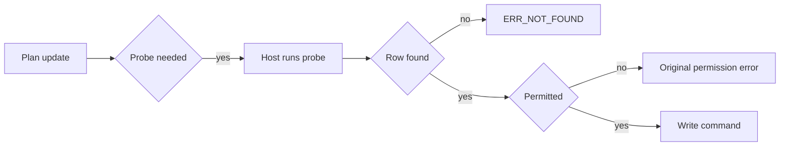
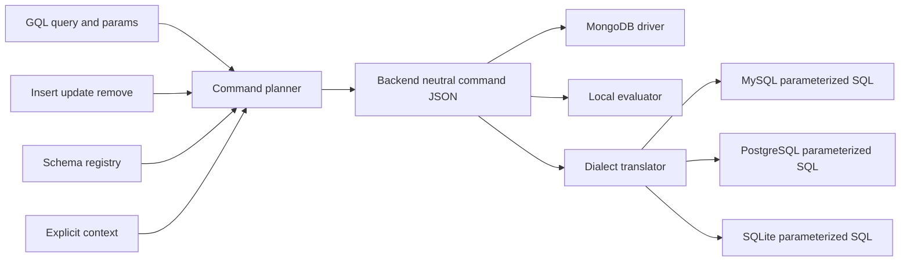

# rust-store

**多后端数据访问的纯逻辑 Rust 核心：GQL 进，后端无关的命令 JSON 出，按需翻译成 MySQL / PostgreSQL / SQLite 的参数化 SQL —— 无驱动、无 IO、无时钟。**


当前发布 **5.3.2** —— crates.io 上是 `rust-store-core`，npm 上是 `rust-store-node`，PyPI 上是 `rust-store-py`。

> English: [README.md](./README.md)

- 一门查询语言只规划一次，在 MongoDB、MySQL、PostgreSQL、SQLite 上执行。
- 两个绑定只做 JSON 转换，所以 Node.js 与 Python 不可能各自漂移。
- 30 个文件、380 个测试函数钉住契约；引擎从不打开连接。

---

## 凌晨两点，同一张表，两个答案

设想凌晨两点值班的工程师。他面对同一张 `orders` 表，看到两个数字。

MongoDB 部署显示每张订单最新的三条明细 —— 运营团队刷了一整天的那个视图。PostgreSQL 部署显示全部明细。订单 8841 一边 3 条，另一边 11 条。**87 张订单对不上**。没有异常抛出：两条语句都解析成功，都返回了行，代码评审时都看着正确。

那条语句是手写的。一次重构里，限制「每个父记录取前 N 条子记录」的那段子句 —— 按外键分区的窗口函数 —— 被删掉了。应用无从发现，因为没有任何一层知道少了一个子句。**MongoDB 一直是对的；第二个答案只是在回答另一个问题。**

修法不是写一条更好的 SQL 字符串，而是不再手写第二个答案。一条查询现在只规划一次，落成一种规范形态 —— MongoDB 命令 JSON；每一个关系型答案都由一个纯函数从这形态推导出来，而这个函数必须**大声说明**自己翻译不了什么。

**命令规划器是主角，SQL 只是它的影子。** 这个仓库就是这件事。

## 它实际做什么

`rust-store-core` 接收三样输入 —— 一份 schema 注册表、一条 GQL 查询或一份写入载荷、一个显式的权限上下文 —— 产出交给宿主执行的惰性 JSON 命令。同一批命令随后仍然不碰数据库，被翻译成关系型后端的参数化 SQL。没有缓冲、没有重试、没有替你做执行：每个公开步骤都是一个 `input -> output` 函数，不启服务就能单测。

| 关注点 | `rust-store-core` | 宿主（`nodejs-store` / `py-store` / 你的服务） |
| --- | --- | --- |
| GQL 解析与校验 | 是 | — |
| 命令规划（find / aggregate / 写） | 是 | — |
| MongoDB 命令 JSON → SQL 翻译 | 是 | — |
| 平铺 JOIN 行 → 嵌套文档 | 是 | — |
| 权限判定（schema / 字段 / 关系 / 行） | 是 | — |
| `agg` 计算列 | 引擎内联求值 | — |
| `fn` / `asyncFn` 计算列 | 声明并注入依赖 | 执行回调 |
| 连接、连接池、事务、重试 | — | 是 |
| DDL、索引、迁移 | — | 是 |
| 时钟、ID 生成、随机数 | — | 是 |

读路径的输出是一个 `QueryPlan` —— `{ collection, mode, commands, postprocess, sort }`。其中 `commands` 是 MongoDB 命令 JSON，携带一个位置四元组（`source`、`database`、`schema`、`collection`），宿主据此知道该用哪条连接。写入返回一条 `command`，外加文档落库后的样子（已补齐默认值与计算值）。

## 它如何工作

### MongoDB 是规范方言

规划只发生一次，落成 MongoDB 驱动本来就懂的语句：`find`、`aggregate`、`countDocuments`、`insertOne`、`updateMany`、`deleteMany`。关系由引擎编译成 `$lookup` / `$addFields`；`$pipeline` 直通已被移除，出现即解析错误，而不是静默空操作。SQL 再由同一条命令经 `dialect::translate` 产出，不存在第二套需要同步的查询模型。

方言分歧只发生在翻译这一层：PostgreSQL 用 `$n` 占位符和 `RETURNING`；MySQL 与 SQLite 用 `?`；标识符在 MySQL 上反引号，其余双引号。根级 `$group` / `$having` 变成 `GROUP BY` / `HAVING`；关系聚合谓词变成 `EXISTS` / `NOT EXISTS`；关系滚动的 `agg` 列变成派生表 `LEFT JOIN`；按父取前 N 变成 `ROW_NUMBER() OVER (PARTITION BY fk ORDER BY ...)` —— 正是那个夜里缺失的子句。

### 翻译不了就出一张回执，不猜

`translate` 返回 `{ backend, stmts, warnings, unsupported }`。当某一段无法安全下推时，`stmts` 会刻意省略它，`unsupported` 点名 code、别名与原因。宿主必须拒绝或降级；**绝不能把它当成完整查询去执行**。两阶段计划使用 `PHASE1_IDS` 占位符，由宿主用第一条命令取回的 id 替换，再调用 `restore_sort_order` 把最终列表恢复成调用方要求的顺序。

同一规则贯穿 core：未知 GQL 子句、schema 外字段、没有 `$group` 的 `$having`、空条件的批量写 —— 全部报错。没有任何分支会悄悄产出一条更弱的查询。

### 权限是 schema 数据，上下文必须显式

读、写角色按 schema、字段、关系、计算列分别声明，除 `internal` 外没有硬编码。有效角色集与声明清单比对；显式豁免清单可以绕过；显式拒写清单优先；RBAC 叠加层追加表级与行级限制，拒绝压过允许。`creator` 是伪角色，动态解析为「文档的 owner 键等于 `ctx.userId`」。声明式 `accessKeys` 提供行级过滤：宿主在 `ctx` 传入对应数组，引擎把它并入读条件与写校验，并按后端下推为原生 `$in`、`JSON_OVERLAPS`、`&&` 或 `json_each`。

上下文是每个规划调用上的显式参数 —— 没有 async-local storage，没有隐式环境用户。省略即「无上下文」。`require_context` 默认为关闭，以对齐原始实现；在启动时打开，并让真正的内部调用传 `Context::system()`，就能得到 fail-secure 行为。

### 本版钉死的三个行为

1. **错误有三种状态，不是两种。** 需要先做归属探测的写操作返回 `needsProbe`；宿主执行后重入。探测匹配不到行，结果是 `ERR_NOT_FOUND:` —— 绝不是权限错误，因为「已删除」和「不是你的」会把用户指向不同的人。行存在但调用方无权触碰时，保留原始权限措辞（`ERR_PERMISSION:ACCESS:` 等），不重新包装。
2. **`creator` / `owner` 权限自带字段与列。** schema 的 `read` 或 `write` 含 `creator` 时，注册期就补上 owner 键 —— 默认 `createdBy`，可用 `ownerKey` 改名，永不为 `_id`；显式声明则保留声明类型。插入时若尚未设置，就从 `ctx.userId` 填充，显式 owner 永不被覆盖。宿主的 DDL 生成器按同一规则加列，所以合法 schema 不会以未知列的身份到达 SQL。
3. **schema 的 `default` 在落库前生效。** 插入路径只为缺失的键填声明过的默认值：显式值优先，显式 `null` 保留为 `null`，没有默认值的字段不会补类型零值。同一规则也喂给返回文档，所以「写了什么」与「拿回什么」不可能互相矛盾。



## 跑起来

```bash
cargo add rust-store-core     # Rust 库，crates.io
npm i rust-store-node         # Node 绑定；平台原生包随 optionalDependencies 分发
pip install rust-store-py     # Python 绑定，maturin 构建
```

注册一份 schema、规划一次读取，再把命令翻译到每个关系型后端。下面这段是公开 Rust API，取自 `core/tests/parity_dialect.rs`：

```rust
use serde_json::{json, Map};

use rust_store_core::command::plan_query;
use rust_store_core::dialect::{translate, Backend};
use rust_store_core::permission::Context;
use rust_store_core::schema::Registry;

fn main() -> Result<(), String> {
    let mut registry = Registry::new();
    registry.register(&json!({
        "name": "Order",
        "collection": "orders",
        "timestamps": false,
        "fields": {
            "code":   { "type": "string" },
            "status": { "type": "string" },
            "amount": { "type": "float" }
        },
        "relations": {}
    }))?;

    let mut params = Map::new();
    params.insert(
        "c0".to_string(),
        json!({ "status": "paid", "amount": { "$gte": 10 } }),
    );

    // 纯规划：不打开连接，不读时钟。
    let plan = plan_query(
        "Order($condition:@c0){ code, amount }",
        &params,
        &registry,
        Some(&Context::system()), // 内部调用：权限放行，不注入 owner
    )?;

    let cmd = plan.commands.first().ok_or("query planned no command")?;

    for backend in [Backend::Mysql, Backend::Postgres, Backend::Sqlite] {
        let out = translate(backend, cmd, &registry)?;
        if !out["unsupported"].as_array().map_or(false, |a| a.is_empty()) {
            // `stmts` 已省略不支持的那一段：拒绝或降级。
            eprintln!("{}: incomplete -> {}", backend.as_str(), out["unsupported"]);
            continue;
        }
        println!("{}: {}", backend.as_str(), out["stmts"][0]["text"]);
    }

    Ok(())
}
```

Node 与 Python 绑定暴露同样的调用，分别叫 `planQuery` / `plan_query` 与 `dialectTranslate` / `dialect_translate`，camelCase 与 snake_case 一一对应。Node 绑定抛异常，Python 绑定抛 Python 异常，从不把错误混进结果对象。

## 边界：什么时候不要用

- **没有连接、连接池、事务。** 引擎交回命令。`plan_claim` 与 `plan_compare_and_set` 产出 `atomic_commands` 序列，必须在同一连接、同一事务里顺序执行 —— 顺序、隔离与重试归宿主。
- **没有 DDL，没有迁移。** `CREATE TABLE`、`ALTER`、索引与回填都在宿主。注册 schema 只做校验，不改你的数据库。
- **没有身份，不写策略。** 它只评估 schema 声明了什么。它不知道用户是谁，不存用户，不做认证。`require_context` 默认关闭；忘记打开的服务在配置层面就是 fail-open。
- **没有时钟、ID、随机数。** `now` 与 `new_id` 由调用方提供。`local` 求值器把集合当 JSON 收下、返回文档，持久化是别人的事。
- **不是 ORM。** 没有实体、延迟关系、工作单元、变更追踪 —— 只有计划和命令。
- **不是网关。** 联邦规划把一条 GQL 拆到多个源并返回 join 边；执行这些源、合并结果留在宿主。自然语言入口是受限的 `text2query` 档，不是通用 NL 层。

## 它在家族里的位置

`rust-store` 是引擎；[`nodejs-store`](https://github.com/coenddt/nodejs-store) 与 [`py-store`](https://github.com/coenddt/py-store) 是持有驱动、事务与回调的宿主；[`store-api`](https://github.com/coenddt/store-api) 这类协议皮坐在它们之上。如果你只想使用数据层，装一个宿主就够了 —— 本仓库在你构建、调试、扩展引擎本身，或为另一种语言写宿主时才重要。

## 一图看懂



三句话：查询只规划一次，落成 MongoDB 命令；SQL 由同一条命令纯函数推导，翻译不了就明说；权限和默认值都在规划期钉死，执行永远留给宿主。
